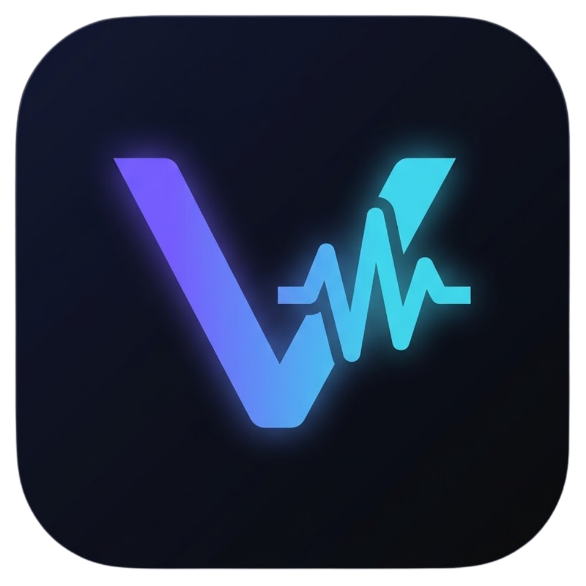

# voxline



a transparent, glowing, always-on-top lyric overlay that follows your spotify playback in real time. free, no account beyond spotify itself, no subscription, no watermark, no "upgrade to pro" popup guilt-tripping you every 5 minutes.


**closed source.** you get the exe, not the code. sorry not sorry.

## download

grab the latest `voxline.exe` from the [releases page](../../releases). that's the whole install process. no installer wizard, no "select components," no admin rights, no toolbar it tries to sneak onto your desktop. the .net runtime is baked into the exe, so it just runs.

## first time setup (about 2 minutes, once)

voxline needs to talk to spotify on your behalf, and spotify makes every app register itself. this isn't voxline being difficult, it's just how spotify's api works for literally everyone:

1. go to the [spotify developer dashboard](https://developer.spotify.com/dashboard) and log in with your normal spotify account.
2. click **create app**. name it whatever you want, spotify doesn't care and neither do we.
3. for **redirect uri**, paste exactly:
   ```
   http://127.0.0.1:8888/callback
   ```
4. save, open the app, copy the **client id** and **client secret**.
5. next to `voxline.exe`, make a file called `spotify_credentials.json`:
   ```json
   { "client_id": "YOUR_CLIENT_ID", "client_secret": "YOUR_CLIENT_SECRET" }
   ```
6. run `voxline.exe`. a browser tab pops up once asking you to approve access, click agree, done. it remembers you after that, no daily relogin nonsense.

## using it

- **drag** the panel anywhere. drag near an **edge or corner** to resize, the text shrinks or grows on its own to keep fitting.
- **right click** for the menu: settings, search / override lyrics, hide to tray, quit.
- **f4** opens settings: colors, glow, opacity, font size, timing offset, always on top, launch at login.
- **space** freezes the current line, in case you want to stare at one lyric for dramatic effect.
- there's a tray icon near the clock that keeps it alive while hidden, double click to bring the overlay back.

## lyrics sources

voxline checks [lrclib](https://lrclib.net) first (free, community, actually time synced), then falls back to [genius](https://genius.com) for plain text if nothing synced turns up. if it grabs the wrong song or comes up empty, right click, search / override lyrics, and either pick the right one or paste your own.

genius fallback is optional. grab a free token from [genius.com/api-clients](https://genius.com/api-clients) and drop it next to the exe in a `genius_credentials.json`:
```json
{ "access_token": "YOUR_GENIUS_TOKEN" }
```
skip it and voxline just uses lrclib.

## notes

- windows only. works with spotify free or premium, voxline only reads what's playing, it doesn't need premium's playback controls.
- not affiliated with spotify or genius, we just really like reading lyrics while pretending to work.
- your spotify login never leaves your machine except to talk to spotify itself.
